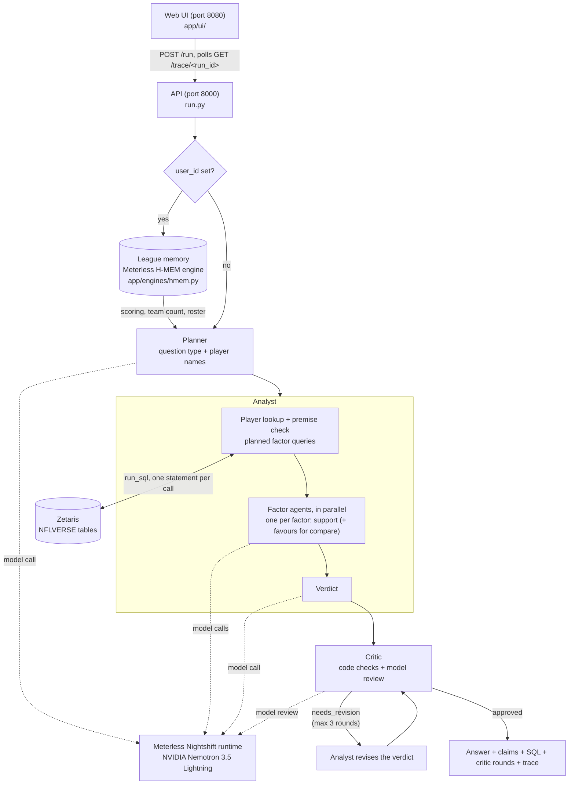

# NFL Fantasy Agent

A multi-agent assistant for **fantasy football managers** making waiver and lineup
decisions. Ask it a question in plain English ("Mike Evans is out, who becomes the
WR1?", "Williams or Pickens?") and it answers with a verdict, the numbers behind
each claim, and the SQL and rows those numbers came from.

**Open Agent Hackathon 2026, Track 2: The Agent That Can Explain Why.**

**The problem.** Fantasy advice is usually a hot take with no evidence, and when a
model writes it, it can sound confident while quoting numbers that don't exist,
naming the wrong team, or blaming a change on an injury that happened after it.
This agent answers only from nflverse data. A Critic agent checks every answer
against that data before you see it, including whether the timing of an
explanation holds up, and sends it back for revision if it doesn't.

Every answer ends with: *Informational only, based on nflverse data; not betting advice.*

---

## Architecture



Every model call goes through `app/adapters/meterless.py`, and every data query goes
through `app/adapters/zetaris.py` (`run_sql`). Each call has a timeout and a fallback.
When a model call fails or runs out of time, that step uses fixed code rules instead,
and the reply says which steps a model produced and which the rules produced.

### The agents

- **Planner** (`app/agents/planner.py`): one small model call sorts the question into a
  type and pulls out the player names. If that call fails, keyword rules take over.
- **Analyst** (`app/agents/analyst.py`, `app/agents/factor_queries.py`):
  - **Lookup and premise check:** code looks the player up in this season's rosters and
    checks the question's premise.
  - **Factor queries and agents:** code runs a fixed set of SQL queries for that
    question type. A small factor agent then rates each factor on its own facts as
    strong, moderate, weak or not supported. The agents run in parallel and share one
    time window; any factor without a reply is rated by thresholds.
  - **Verdict:** one more call writes the verdict from the rated factors.
  - **Claims:** these are code-computed facts, each with the SQL and rows it came from.
- **Critic** (`app/agents/critic.py`): code checks first, then an optional model review.
  - (a) **verdict support:** the player recommended is the one the usage numbers back.
  - (b) **numbers:** every number in the answer appears in the cited rows or the facts
    computed from them.
  - (c) **artifacts:** no copied prompt labels, no counts like "3.0 games", no missing
    values, and every percentage has its % sign.
  - (d) **question fit:** a why answer explains first; a replacement answer never picks
    up the player who is out.
  - (e) **timing:** "his target share rose after X got hurt" must start in that week,
    and not before.
  - (f) **league memory:** don't pick up a player already rostered; quote points in
    the league's scoring.
  - (g) **compare:** start exactly one of the two players, follow the head-to-head
    numbers, and quote numbers for both.
  - **Revision loop:** blocking issues send the verdict back for revision, for at most
    3 critic rounds (`app/pipeline.py`). Only the verdict step reruns; the factor agents
    do not.

### Question types

| Type | Example | What the Analyst queries |
|---|---|---|
| `why` | "Why is Christian Watson scoring so many fantasy points?" | Status, then six factors: opportunity, teammate absences, team pass rate and game script, big plays, touchdowns and red zone, matchups |
| `replacement` | "Who becomes the Bucs' WR1 if Mike Evans is out?" | Status, team usage, depth chart, games without the player. The answer leads with the depth chart's next man up, then says who the target share points to for fantasy |
| `compare` | "I have Jameson Williams on my bench and George Pickens in my lineup, who should I pick?" | Both players, head to head: weekly opportunity, team usage share, recent trend (weeks 1-3 vs 4-6), touchdown share, next opponent's points allowed to the position. Verdict: "Start A over B" |
| `start_sit` | "Should I start Christian Watson this week?" | Status, team usage, depth chart |
| `waiver` | "Should I pick up Jauan Jennings?" | Status, team usage, depth chart |

**Premise correction.** If the question names the wrong team, the agents correct it
from the rosters table before answering. In the 2026 data, Mike Evans is on the 49ers,
so "the Bucs' WR1" comes back with *"Mike Evans is on SF in the data (rosters, week 7),
not TB."* The agents then answer for SF.

**League memory.** With a `user_id`, the agent stores what the question says about the
user's league, using the Meterless H-MEM engine:
- **Stored facts:** team count, scoring (PPR, half-PPR, standard), rostered players
  ("my TE is George Kittle", "Williams on my bench") and dropped players.
- **Use in answers:** later questions retrieve these facts. Points are computed in the
  league's scoring, and players already on the roster are not recommended as pickups.
- **Extraction:** code extracts the facts; a model call is used only when code finds
  league cues it can't parse.

---

## Quick start

### Docker (no credentials needed)

```bash
docker build -t nfl-agent .
docker run -p 8000:8000 -p 8080:8080 nfl-agent
```

Open <http://localhost:8080>. With no env file the container uses **sample mode**:
- **Data:** SQL runs on DuckDB against the committed `data/sample/` Parquet files,
  using the same SQL as live mode.
- **Model steps:** with no model configured, **every factor rating, verdict and critic
  review is rule-based.** The agents still run their real logic on the data; only the
  model calls are replaced by fixed rules. Nothing is a pre-written answer.

### Python venv

```bash
python -m venv .venv
.venv/bin/pip install -r requirements.txt   # Windows: .venv\Scripts\pip install -r requirements.txt
.venv/bin/python run.py                     # Windows: .venv\Scripts\python run.py
```

`python run.py` with no question starts both servers (API on 8000, UI on 8080), the same
as `python run.py --serve`; `--port`, `--ui-port` (or `PORT`, `UI_PORT`) and `--no-ui`
change that. A port already in use fails to bind; it is never shared.

Python 3.10+. Dependencies: duckdb, nflreadpy, polars, pytest. The servers use the
standard library.

### Live mode

Copy `.env.example` to `.env` and fill it in. `.env` is gitignored, and the example
file has placeholders only.

- `METERLESS_BASE_URL`, `METERLESS_RUNTIME_TOKEN`, `METERLESS_MODEL`
  (`nvidia/nemotron-3.5-lightning-30b-a3b`) for the Nightshift runtime.
- `SAMPLE_MODE=false` plus `ZETARIS_BASE_URL`, `ZETARIS_ORG_ID` and an API key or a
  username and password for the Zetaris cluster.
- Optional: `CRITIC_MODEL_REVIEW=false` (code checks only), `MEMORY_DIR`.

```bash
docker run -p 8000:8000 -p 8080:8080 --env-file .env nfl-agent
```

From inside Docker, `127.0.0.1` is the container itself. A Nightshift runtime on your
machine is `METERLESS_BASE_URL=http://host.docker.internal:8088`; on Linux, also pass
`--add-host=host.docker.internal:host-gateway`.

---

## Using it

### Web UI

On <http://localhost:8080>:
- **Asking:** type a question, or click an example chip. An optional user ID turns on
  league memory.
- **While it runs:** the page polls `GET /trace/<run_id>` and shows each agent step
  live, labelled with the sponsor technology behind it, plus an elapsed-time counter.
- **Results:** the final answer comes first. The answer before the critic is shown
  side by side with the final answer, with the blocking issue between them. Factor
  cards, claims with their SQL, critic rounds and timings are collapsed by default.
  There's also a "Download trace (JSONL)" link.

### API

`POST /run`:

```bash
curl -X POST http://localhost:8000/run -H "Content-Type: application/json" \
  -d '{"question": "I have Jameson Williams on my bench and George Pickens in my starting lineup, who should I pick?", "user_id": "demo"}'
```

| Field | |
|---|---|
| `question` | required, up to 500 characters |
| `user_id` | optional; turns on league memory |
| `run_id` | optional; 12 hex characters, so a client can poll the trace while the run is going |
| `include_trace` | optional; adds the run's trace lines to the reply |

The reply, shortened from the saved live run in `examples/i-have-jameson-williams-*`:

```json
{
  "run_id": "2d2fcbc02978",
  "answer": "Start George Pickens over Jameson Williams. ... Pickens owns a 21.9% target share and 8.7 targets per game, producing 10.9 half-PPR points, and faces a PHI defense that allows 31.8 half-PPR points per game to WRs (rank 3), far more favorable than Williams' matchup against GB (26 allowed, rank 17). ...",
  "disclaimer": "Informational only, based on nflverse data; not betting advice.",
  "approved": true,
  "answer_before_critic": "...",
  "premise_correction": null,
  "question_type": "compare",
  "players": [{"name": "Jameson Williams", "team": "DET", "position": "WR"},
              {"name": "George Pickens", "team": "DAL", "position": "WR"}],
  "factors": [{"factor": "Weekly opportunity", "support": "strong", "favours": "George Pickens",
               "rated_by": "model", "summary": "...", "evidence": [{"sql": "SELECT ...", "headers": [], "rows": []}]}],
  "claims": [{"text": "...", "evidence": []}],
  "critic": {"approved": true, "rounds": [{"round": 1, "status": "approved", "reviewed_by": "model", "issues": []}]},
  "memory": {"user_id": "demo", "remembered": true, "scoring": "half", "scoring_label": "half-PPR", "teams": 12, "roster": []},
  "steps": {"planner": "model", "memory_mining": "code",
            "factors": {"Weekly opportunity": "model", "Recent trend": "model"},
            "first_verdict": "model", "final_verdict": "model", "critic_reviews": ["model"]},
  "timings": {"total_ms": 128669, "agent_busy_ms": {"planner": 5449, "analyst": 41740, "factor_agent": 90503, "critic": 57807}}
}
```

Other routes:
- `GET /health` returns `{"status", "sample_mode", "model_configured"}`.
- `GET /trace/<run_id>` returns the trace lines so far; when the run is done it also
  returns the result.
- `GET /trace/<run_id>.jsonl` downloads the trace.
- Errors are `{"error", "message"}` JSON with a 4xx/5xx status, never a stack trace.

### CLI

With the venv active (or with `.venv/bin/python` in place of `python`):

```bash
python run.py "Why is Christian Watson scoring so many fantasy points this season?"
python run.py "Who should I start, Jameson Williams or George Pickens?" --user demo
python scripts/try_pipeline.py --live "question"   # live run, saved under examples/
```

### Traces

Every agent step writes one JSON line to stdout and to `logs/trace-<YYYYMMDD>.jsonl`.
- **Fields on every line:** `timestamp`, `run_id`, `agent_name`, `action`,
  `target_agent`, `status`, `retry_count`, `sql`, `model` and `rows_returned`.
- **Step-specific fields:** for example `duration_ms`, `support`, `favours`,
  `rated_by` and `reason` on a fallback.
- **Which model answered:** `model` is the routed model the runtime reported
  (`meterless.routed_model`).

### Tests and CI

```bash
pytest           # 318 tests
```

The tests cover:
- the Planner and its keyword fallback
- every factor query on the sample data
- the factor agents, including their timeouts and rule fallbacks
- each critic check, on saved answers
- the revision loop and league memory (including two processes)
- the H-MEM engine, including its conflict, sleep and dreaming services against the
  official conformance vectors
- the API, CORS and `/trace` while a run is in progress
- the UI files

The model is stubbed, so the tests need no credentials.

CI (`.github/workflows/ci.yml`) runs the test suite on every push. It then builds the
Docker image and runs it **with no env file**. In that container it checks:
- `/health`
- a `POST /run` for the Watson question, which must answer with the disclaimer and
  rule-based steps
- `/trace/<run_id>` for that run
- the UI on port 8080, and the CORS header for the UI's origin

---

## Examples

Live runs saved by `scripts/try_pipeline.py --live`. Each folder has `answer.md` (readable),
`response.json` (the API reply), `result.json` and `trace.jsonl`. Older runs are in
[`examples/archive/`](examples/archive/README.md).

| Example | Data | Model vs rule-based steps | Result |
|---|---|---|---|
| [Why is Christian Watson scoring so many fantasy points?](examples/why-is-christian-watson-scoring-so-many-fantasy-points-this/20261025-162014-c86443db3074/answer.md) | live Zetaris | planner, 6/6 factors, final verdict: model; first verdict, critic reviews: rules | 2 critic rounds, approved; 349.9s |
| [Who becomes the Bucs' WR1 if Mike Evans is out?](examples/who-becomes-the-bucs-wr1-if-mike-evans-is-out/20261025-171146-c8005cf773a5/answer.md) (wrong premise) | live Zetaris | planner, 3/3 factors, verdict: model; critic review: rules | Corrects TB to SF; "Deebo Samuel is next at WR on the depth chart, but the target share points to George Kittle (24.9%), so for fantasy: pick up George Kittle." 148.4s |
| [Half-PPR league memory (c1)](examples/12-team-half-ppr-my-te-is-george-kittle-and-my-wr-is-davante/20261025-171545-737f52e76684/answer.md): "12-team half-PPR, my TE is George Kittle…" | live Zetaris | planner, 2/3 factors: model; Team usage, verdict, critic review: rules | Skips rostered Kittle; picks up Christian McCaffrey (22.8%), 18 half-PPR points per game. 238.5s |
| [Half-PPR league memory (c2)](examples/should-i-pick-up-a-49ers-receiver-if-evans-misses-time/20261025-171850-c6bfcb00aeb7/answer.md): "Should I pick up a 49ers receiver if Evans misses time?" | live Zetaris | planner, 3/3 factors: model; verdict, critic review: rules | Treated as a replacement question; picks up McCaffrey, not Evans. 184.9s |
| [Jameson Williams vs George Pickens](examples/i-have-jameson-williams-on-my-bench-and-george-pickens-in-my/20261025-180054-2d2fcbc02978/answer.md) | live Zetaris | every step: model | "Start George Pickens over Jameson Williams", half-PPR, both stored as rostered. 1 round, 128.7s |
| [Critic demo](examples/critic-demo-who-becomes-the-bucs-wr1-if-mike-evans-is-out/20261025-125256-5cfacb69069d/answer.md) (**starts from a saved Analyst answer**, not a fresh run) | saved query rows from the Oct 22 run | the Analyst is not rerun; critic reviews and revised verdict: rules (model calls fell back) | Round 1 blocks "Start Deebo Samuel" (11.1% target share vs Kittle's 24.9%) and two copied `[strong]` labels; round 2 approves "Pick up George Kittle". 170.8s |

"Rules" means the model call for that step failed or timed out and the code rules
answered; each `answer.md` lists this at the top.

---

## Sponsor technology

The longer version is in [docs/sponsor-technology.md](docs/sponsor-technology.md).

- **Zetaris:** all live data comes from a Zetaris cluster.
  - **Tables:** seven nflverse tables (`player_stats`, `pbp`, `snap_counts`,
    `depth_charts`, `injuries`, `rosters`, `schedules`) are registered as `NFLVERSE`
    filestore tables over Parquet on S3 (`sql/nflverse_create.sql`) and cached
    (`sql/nflverse_cache.sql`).
  - **Queries:** every fact in an answer comes from a SQL query through `run_sql`, one
    statement per call. The queries are plain SQL that runs on both Spark SQL and
    DuckDB.
  - **Spark sweep:** `scripts/check_factor_queries_live.py` runs every planned query,
    for every question type including compare and in every scoring, against the live
    cluster. It catches SQL that DuckDB accepts but Spark rejects. Last run: 148 distinct
    queries, 0 SQL errors.
- **Meterless:**
  - **Nightshift runtime:** the only model provider, reached through its
    OpenAI-compatible API in `app/adapters/meterless.py`.
  - **H-MEM engine:** implemented in Python from the official spec
    (`app/engines/hmem.py`), with all seven services in the spec, including the
    sleep cycle, conflict detection and dreaming. It powers the league memory feature.
    <!-- TODO before submitting: rerun the official runner and replace the next sentence with its score. -->
    All 13 conformance vector checks pass in our runs through the bridge; the official
    runner scored **10 of 13** before the last three services were added
    ([docs/hmem-conformance.md](docs/hmem-conformance.md)).
- **NVIDIA:** every agent's model is Nemotron 3.5 Lightning
  (`nvidia/nemotron-3.5-lightning-30b-a3b`), served through Nightshift. The routed
  model the runtime reports is recorded in each `model_call` trace line and in the
  reply's `timings.model_calls`. The Nightshift Console's Proof page keeps a receipt per
  request: app `nfl-agent`, routed by `meterless/auto` to Nemotron 3.5 Lightning 30B A3B,
  with input and output tokens and the cost ($0). Its Apps page lists the app, named by
  the adapter's `meterless-app` header.

  
  
- **Claude Code:** the project was built with Claude Code, from `CLAUDE.md`'s rules
  (adapters only, one SQL statement per call, traces, sample mode, 3 critic rounds).
  The commits are co-authored by Claude.

**What was unique:**
- **The Critic tests timing.** "His target share rose after Jayden Reed got hurt" is
  checked week by week against the data. It's blocked if the rise doesn't start that
  week, or had already started.
- **Wrong premises are corrected from the data** before any agent sees the question.
- **Factor agents are small and parallel**, each seeing only one factor's facts, with a
  rule fallback, so a slow model never leaves the user without an answer.
- **Every answer says which steps a model produced and which the code rules produced.**

---

## Data and licences

- **nflverse** data via [nflreadpy](https://github.com/nflverse/nflreadpy), **CC-BY 4.0**.
- **FTN charting data** is licensed **CC-BY-SA 4.0**, *"FTN Data via nflverse"*. It is
  credited here as the project requires; the current build does not load the FTN
  charting table itself.
- **Season:** 2026, weeks 1-6 of stats, with rosters and depth charts as of week 7 and
  schedules to week 18. Built by `scripts/build_sample_data.py`. `data/sample/` holds
  the committed copy (under 5 MB per table); `data/full/` is gitignored.

Code: MIT ([LICENSE](LICENSE)), except the parts adapted from Apache-2.0 projects
listed under Credits ([LICENSES/Apache-2.0.txt](LICENSES/Apache-2.0.txt)).

## Credits

- `app/adapters/zetaris.py` is adapted from
  [`scripts/query_zetaris.py`](https://github.com/zetaris/getting-started/blob/main/scripts/query_zetaris.py)
  (the UI-proxy run-query call) and its helper `scripts/zetaris_api.py` (the authenticated
  request) in [zetaris/getting-started](https://github.com/zetaris/getting-started), Apache-2.0.
  The file's header lists what we changed; the licence text is in
  [`LICENSES/Apache-2.0.txt`](LICENSES/Apache-2.0.txt).
- Meterless H-MEM spec, [github.com/Meterless/Meterless](https://github.com/Meterless/Meterless)
  `engines/hmem` (Apache-2.0), implemented in `app/engines/hmem.py`. Its deterministic
  embedder is a Python port of the reference's FNV-1a mock embedder.
- Team:
  - Aaron Du.
  - Justin Chen: slide deck, demo script, and the H-MEM conflict detection, sleep cycle
    and dreaming services.

## Limitations

- **Slow model calls.** Nightshift doesn't forward `enable_thinking=false`, so Nemotron
  always reasons first.
  - **Call times:** a single call takes about 10-90s.
  - **Fallbacks:** some steps hit their time limit and fall back to the code rules. This
    happens most often with the critic's model review, which is capped at 90s.
- **Run time.** A run takes about 2-6 minutes (128.7s to 349.9s in the examples above).
  The run budget is 360s.
- **Snapshot data.** The data is a weekly snapshot (through week 6), not a live feed.
- **No league import.** The agent knows your league only from what you type into your
  questions.
- **Self-hosted only.** Run it yourself with Docker or Python; there is no hosted
  deployment.
- **Compare needs full names.** The keyword fallback recognises a two-player compare
  question only when both players' full names are given.

## Pre-existing work

None. Everything in this repository was built during the hackathon, starting
22 October 2026 (first commit).
