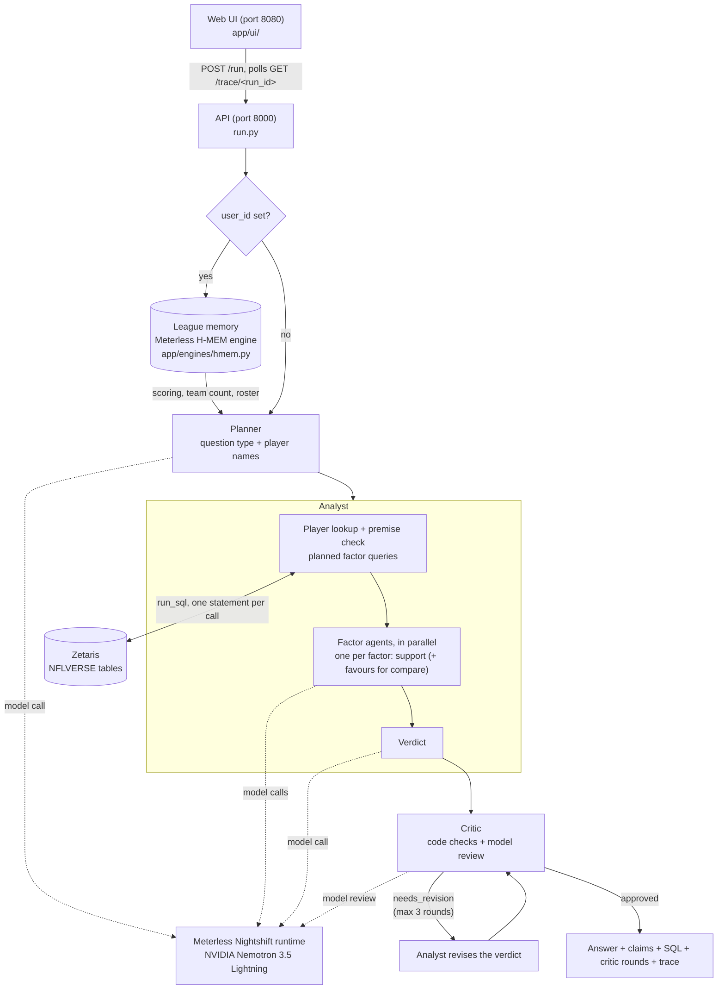

# NFL Fantasy Agent

A multi-agent assistant for **fantasy football managers** making waiver and lineup
decisions. Ask it a question in plain English ("Mike Evans is out, who becomes the
WR1?", "Williams or Pickens?") and it answers with a verdict, the numbers behind
each claim, and the SQL and rows those numbers came from.

**Open Agent Hackathon 2026, Track 2: The Agent That Can Explain Why.**

**The problem.** Fantasy advice is usually a hot take with no evidence, and when a
model writes it, it can sound confident while quoting numbers that don't exist,
naming the wrong team, or blaming a change on an injury that happened after it.
This agent answers only from nflverse data. A Critic agent checks every answer
against that data before you see it, including whether the timing of an
explanation holds up, and sends it back for revision if it doesn't.

Every answer ends with: *Informational only, based on nflverse data; not betting advice.*

## Try it in 60 seconds

Sample mode needs no credentials: the committed data sample, and code rules for every
model step. Start it one of two ways:

```bash
docker build -t nfl-agent . && docker run -p 8000:8000 -p 8080:8080 nfl-agent
```

```bash
python -m venv .venv && .venv/bin/pip install -r requirements.txt && .venv/bin/python run.py
```

Then open <http://localhost:8080>, or ask the API:

```bash
curl -X POST http://localhost:8000/run -H "Content-Type: application/json" \
  -d '{"question": "Should I start Jared Goff this week?"}'
```

One question per type:

| Type | Question |
|---|---|
| Start/sit | Should I start Jared Goff this week? |
| Compare | Pickens or Olave? |
| Replacement | Christian McCaffrey is out. Who replaces him? |
| Why | Why is Christian Watson scoring so many fantasy points this season? |
| Status | Is Kyle Monangai playing this week? |
| Out of scope (honest limit) | Should I trade Malik Nabers for Davante Adams? |

### What it doesn't do yet

- Trades
- Rest-of-season value
- FAAB bid amounts
- Streaming picks
- Kickers and defenses
- Questions that name no player ("who should I pick up at RB?")
- Live data after week 6 (the data is a snapshot through week 6)

For questions it can't answer, it says so; a trade question still gets the named players'
numbers for the week. More in [Limitations](#limitations).

---

## Architecture



Every model call goes through `app/adapters/meterless.py`, and every data query goes
through `app/adapters/zetaris.py` (`run_sql`). Each call has a timeout and a fallback.
When a model call fails or runs out of time, that step uses fixed code rules instead,
and the reply says which steps a model produced and which the rules produced.

### The agents

- **Planner** (`app/agents/planner.py`): one small model call sorts the question into a
  type and pulls out the player names. If that call fails, keyword rules take over.
- **Analyst** (`app/agents/analyst.py`, `app/agents/factor_queries.py`):
  - **Lookup and premise check:** code looks the player up in this season's rosters and
    checks the question's premise.
  - **Factor queries and agents:** code runs a fixed set of SQL queries for that
    question type. A small factor agent then rates each factor on its own facts as
    strong, moderate, weak or not supported. The agents run in parallel and share one
    time window; any factor without a reply is rated by thresholds.
  - **Verdict:** one more call writes the verdict from the rated factors.
  - **Claims:** these are code-computed facts, each with the SQL and rows it came from.
- **Critic** (`app/agents/critic.py`): code checks first, then an optional model review.
  - (a) **verdict support:** the player recommended is the one the usage numbers back.
  - (b) **numbers:** every number in the answer appears in the cited rows or the facts
    computed from them.
  - (c) **artifacts:** no copied prompt labels, no counts like "3.0 games", no missing
    values, and every percentage has its % sign.
  - (d) **question fit:** a why answer explains first; a replacement answer never picks
    up the player who is out.
  - (e) **timing:** "his target share rose after X got hurt" must start in that week,
    and not before.
  - (f) **league memory:** don't pick up a player already rostered; quote points in
    the league's scoring.
  - (g) **compare:** start exactly one of the two players, follow the head-to-head
    numbers, and quote numbers for both.
  - **Revision loop:** blocking issues send the verdict back for revision, for at most
    3 critic rounds (`app/pipeline.py`). Only the verdict step reruns; the factor agents
    do not.

### Question types

| Type | Example | What the Analyst queries |
|---|---|---|
| `why` | "Why is Christian Watson scoring so many fantasy points?" | Status, then six factors: opportunity, teammate absences, team pass rate and game script, big plays, touchdowns and red zone, matchups |
| `replacement` | "Who becomes the Bucs' WR1 if Mike Evans is out?" | Status, team usage, depth chart, games without the player. The stand-in is a player at the same position ranked below him on the depth chart who can play (not Out or on reserve), ranked by carries for RBs, by depth for QBs and by recent target share for WRs and TEs |
| `compare` | "I have Jameson Williams on my bench and George Pickens in my lineup, who should I pick?" | Both players, head to head: weekly opportunity, team usage share, recent trend (weeks 1-3 vs 4-6), touchdown share, next opponent's points allowed to the position. Verdict: "Start A over B" |
| `start_sit` | "Should I start Christian Watson this week?" | Status, team usage, depth chart |
| `waiver` | "Should I pick up Jauan Jennings?" | Status, team usage, depth chart |

**Premise correction.** If the question names the wrong team, the agents correct it
from the rosters table before answering. In the 2026 data, Mike Evans is on the 49ers,
so "the Bucs' WR1" comes back with *"Mike Evans is on SF in the data (rosters, week 7),
not TB."* The agents then answer for SF.

**League memory.** With a `user_id`, the agent stores what the question says about the
user's league, using the Meterless H-MEM engine:
- **Stored facts:** team count, scoring (PPR, half-PPR, standard), rostered players
  ("my TE is George Kittle", "Williams on my bench") and dropped players.
- **Use in answers:** later questions retrieve these facts. Points are computed in the
  league's scoring, and players already on the roster are not recommended as pickups.
- **Extraction:** code extracts the facts; a model call is used only when code finds
  league cues it can't parse.

---

## Quick start

### Docker (no credentials needed)

```bash
docker build -t nfl-agent .
docker run -p 8000:8000 -p 8080:8080 nfl-agent
```

Open <http://localhost:8080>. With no env file the container uses **sample mode**:
- **Data:** SQL runs on DuckDB against the committed `data/sample/` Parquet files,
  using the same SQL as live mode.
- **Model steps:** with no model configured, **every factor rating, verdict and critic
  review is rule-based.** The agents still run their real logic on the data; only the
  model calls are replaced by fixed rules. Nothing is a pre-written answer.

### Python venv

```bash
python -m venv .venv
.venv/bin/pip install -r requirements.txt   # Windows: .venv\Scripts\pip install -r requirements.txt
.venv/bin/python run.py                     # Windows: .venv\Scripts\python run.py
```

`python run.py` with no question starts both servers (API on 8000, UI on 8080), the same
as `python run.py --serve`; `--port`, `--ui-port` (or `PORT`, `UI_PORT`) and `--no-ui`
change that. A port already in use fails to bind; it is never shared.

Python 3.10+. Dependencies: duckdb, nflreadpy, polars, pytest. The servers use the
standard library. Live mode also needs a Zetaris cluster (the data layer) and the
Meterless Nightshift runtime, with an NVIDIA Nemotron model set up in Nightshift's
Providers tab; sample mode needs neither.

### Live mode

Copy `.env.example` to `.env` and fill it in. `.env` is gitignored, and the example
file has placeholders only.

- `METERLESS_BASE_URL`, `METERLESS_RUNTIME_TOKEN`, `METERLESS_MODEL`
  (`nvidia/nemotron-3.5-lightning-30b-a3b`) for the Nightshift runtime.
- `SAMPLE_MODE=false` plus `ZETARIS_BASE_URL`, `ZETARIS_ORG_ID` and an API key or a
  username and password for the Zetaris cluster.
- Optional: `CRITIC_MODEL_REVIEW=false` (code checks only), `MEMORY_DIR`.

```bash
docker run -p 8000:8000 -p 8080:8080 --env-file .env nfl-agent
```

From inside Docker, `127.0.0.1` is the container itself. A Nightshift runtime on your
machine is `METERLESS_BASE_URL=http://host.docker.internal:8088`; on Linux, also pass
`--add-host=host.docker.internal:host-gateway`.

---

## Using it

### Web UI

On <http://localhost:8080>:
- **Asking:** type a question, or click an example chip. An optional user ID turns on
  league memory.
- **While it runs:** the page polls `GET /trace/<run_id>` and shows each agent step
  live, labelled with the sponsor technology behind it, plus an elapsed-time counter.
- **Results:** the final answer comes first. The answer before the critic is shown
  side by side with the final answer, with the blocking issue between them. Factor
  cards, claims with their SQL, critic rounds and timings are collapsed by default.
  There's also a "Download trace (JSONL)" link.

### API

`POST /run`:

```bash
curl -X POST http://localhost:8000/run -H "Content-Type: application/json" \
  -d '{"question": "I have Jameson Williams on my bench and George Pickens in my starting lineup, who should I pick?", "user_id": "demo"}'
```

| Field | |
|---|---|
| `question` | required, up to 500 characters |
| `user_id` | optional; turns on league memory |
| `run_id` | optional; 12 hex characters, so a client can poll the trace while the run is going |
| `include_trace` | optional; adds the run's trace lines to the reply |

The reply, shortened from the saved live run in `examples/i-have-jameson-williams-*`:

```json
{
  "run_id": "bd5fd37b4a94",
  "answer": "Start George Pickens over Jameson Williams. George Pickens leads in weekly opportunity (8.7 vs 5.8 targets per game) and average target share (21.9% vs 15.2%), which are the strongest factors. He also has a superior matchup this week, facing PHI (31.8 half-PPR allowed, rank 3) while Jameson Williams faces GB (26 allowed, rank 17). ...",
  "disclaimer": "Informational only, based on nflverse data; not betting advice.",
  "approved": true,
  "answer_before_critic": "...",
  "premise_correction": null,
  "question_type": "compare",
  "players": [{"name": "Jameson Williams", "team": "DET", "position": "WR"},
              {"name": "George Pickens", "team": "DAL", "position": "WR"}],
  "factors": [{"factor": "Weekly opportunity", "support": "strong", "favours": "George Pickens",
               "rated_by": "model", "summary": "...", "evidence": [{"sql": "SELECT ...", "headers": [], "rows": []}]}],
  "claims": [{"text": "...", "evidence": []}],
  "critic": {"approved": true, "rounds": [{"round": 1, "status": "needs_revision", "reviewed_by": "model", "issues": ["..."]},
                                       {"round": 2, "status": "approved", "reviewed_by": "model", "issues": ["..."]}]},
  "memory": {"user_id": "demo", "remembered": true, "scoring": "half", "scoring_label": "half-PPR", "teams": 12, "roster": [{"name": "George Kittle", "team": "SF", "position": "TE"}, "..."]},
  "steps": {"planner": "model", "memory_mining": "code",
            "factors": {"Weekly opportunity": "model", "Recent trend": "model"},
            "first_verdict": "model", "final_verdict": "model", "critic_reviews": ["model", "model"]},
  "timings": {"total_ms": 74685, "agent_busy_ms": {"planner": 1822, "analyst": 53288, "factor_agent": 7152, "critic": 14426}}
}
```

Other routes:
- `GET /health` returns `{"status", "sample_mode", "model_configured"}`.
- `GET /trace/<run_id>` returns the trace lines so far; when the run is done it also
  returns the result.
- `GET /trace/<run_id>.jsonl` downloads the trace.
- Errors are `{"error", "message"}` JSON with a 4xx/5xx status, never a stack trace.

### CLI

With the venv active (or with `.venv/bin/python` in place of `python`):

```bash
python run.py "Why is Christian Watson scoring so many fantasy points this season?"
python run.py "Who should I start, Jameson Williams or George Pickens?" --user demo
python scripts/try_pipeline.py --live "question"   # live run, saved under examples/
```

### Traces

Every agent step writes one JSON line to stdout and to `logs/trace-<YYYYMMDD>.jsonl`.
- **Fields on every line:** `timestamp`, `run_id`, `agent_name`, `action`,
  `target_agent`, `status`, `retry_count`, `sql`, `model` and `rows_returned`.
- **Step-specific fields:** for example `duration_ms`, `support`, `favours`,
  `rated_by` and `reason` on a fallback.
- **Which model answered:** `model` is the routed model the runtime reported
  (`meterless.routed_model`).

### Tests and CI

```bash
pytest           # 545 tests
```

The tests cover:
- the Planner and its keyword fallback
- every factor query on the sample data
- the factor agents, including their timeouts and rule fallbacks
- each critic check, on saved answers
- the revision loop and league memory (including two processes)
- the H-MEM engine, including its conflict, sleep and dreaming services against the
  official conformance vectors
- the API, CORS and `/trace` while a run is in progress
- the UI files

The model is stubbed, so the tests need no credentials.

CI (`.github/workflows/ci.yml`) runs the test suite on every push. It then builds the
Docker image and runs it **with no env file**. In that container it checks:
- `/health`
- a `POST /run` for the Watson question, which must answer with the disclaimer and
  rule-based steps
- `/trace/<run_id>` for that run
- the UI on port 8080, and the CORS header for the UI's origin

---

## Examples

Live runs saved by `scripts/try_pipeline.py --live`. Each folder has `answer.md` (readable),
`response.json` (the API reply), `result.json` and `trace.jsonl`. Older runs are in
[`examples/archive/`](examples/archive/README.md).

| Example | Data | Model vs rule-based steps | Result |
|---|---|---|---|
| [Why is Christian Watson scoring so many fantasy points?](examples/why-is-christian-watson-scoring-so-many-fantasy-points-this/20261025-222450-fa9106baf4ee/answer.md) | live Zetaris | planner, 6/6 factors, final verdict, critic reviews: model; first verdict: rules (verdict call failed at 60s) | Round 1 blocks three overstated claims; round 2 approves: 19.8 PPR points per game, inflated by weeks 1-3 (23.1 per game, 25.8% target share) and down to 16.5 in weeks 4-6 (18.6%). Note: the Touchdowns factor card says "20% of his targets are red zone targets"; it is 20% of GB's red-zone targets (7 of 35). The final answer states it correctly. 134.8s |
| [Who becomes the Bucs' WR1 if Mike Evans is out?](examples/who-becomes-the-bucs-wr1-if-mike-evans-is-out/20261026-153339-56933e43f91f/answer.md) (wrong premise) | live Zetaris | every step: model | Corrects TB to SF; "Deebo Samuel is next at WR on the depth chart (11.1% recent target share), so for fantasy: pick up Deebo Samuel." Round 1 blocks the draft's "Kittle (24.9%) and McCaffrey (22.8%) also rank higher": it meant higher than Samuel, but the direction check read it as higher than Evans (a false positive on an ambiguous sentence). Round 2 approves. 71.4s |
| [Half-PPR league memory (c1)](examples/12-team-half-ppr-my-te-is-george-kittle-and-my-wr-is-davante/20261026-153614-17279d592b6c/answer.md): "12-team half-PPR, my TE is George Kittle…" | live Zetaris | planner, factors, first verdict, critic reviews: model; final verdict: rules | Round 1 blocks the model review's push for Kittle and McCaffrey (a TE and an RB, not WRs below Evans); round 2 blocks Kittle as already rostered; round 3 approves the rule-based "pick up Deebo Samuel if available". Note: the Team usage factor card calls Kittle "the effective TE1 by usage if Evans is inactive", which is muddled (Kittle is already the TE1). 155.3s |
| [Half-PPR league memory (c2)](examples/should-i-pick-up-a-49ers-receiver-if-evans-misses-time/20261026-153706-9bb4fcf8f300/answer.md): "Should I pick up a 49ers receiver if Evans misses time?" | live Zetaris | planner, factors, first verdict, critic reviews: model; final verdict: rules | Uses the stored league (half-PPR, Kittle rostered). Round 2 blocks McCaffrey: "not a WR below Mike Evans on the SF depth chart who can play; the stand-ins are Deebo Samuel, Brandin Cooks, Jacob Cowing." Round 3 approves "pick up Deebo Samuel if available". Same Team usage card note as c1. 51.4s |
| [Who should I start Trey Mcbride or Bowers for week 7](examples/who-should-i-start-trey-mcbride-or-bowers-for-week-7/20261025-222827-76a8e6f7a7f6/answer.md) (last name only) | live Zetaris | every step: model | Resolves "Bowers = Brock Bowers, LV TE". Round 1 blocks a "higher target volume edge" for Bowers (McBride has 65 targets to 43); round 2 approves "Start Brock Bowers over Trey McBride" (20.6 vs 17.2 PPR per game), noting McBride's more favorable matchup (DEN, rank 15 of 32, vs LA, rank 31). 43.4s |
| [Jameson Williams vs George Pickens](examples/i-have-jameson-williams-on-my-bench-and-george-pickens-in-my/20261025-222743-bd5fd37b4a94/answer.md) | live Zetaris | every step: model | Same league as c1/c2 (half-PPR). "Start George Pickens over Jameson Williams": 8.7 vs 5.8 targets per game; PHI (rank 3, favorable) vs GB (rank 17). 2 rounds, 74.7s |
| [Should I start Jared Goff this week?](examples/should-i-start-jared-goff-this-week/20261026-154029-bb5537a867d6/answer.md) (QB) | live Zetaris | every step: model | Round 1 blocks a made-up "24.9" points per game (the data says 23); round 2 blocks an opening that is not Start/Sit/Bench; round 3 approves "Start Jared Goff": 23 PPR points per game, 12 passing and 1 rushing touchdowns, despite a tough GB matchup (rank 28 of 32 against QBs). 70.8s |
| [Christian McCaffrey is out. Who replaces him?](examples/christian-mccaffrey-is-out-who-replaces-him/20261026-154131-b381216eeca0/answer.md) (RB stand-in) | live Zetaris | every step: model | "Kaelon Black is next at RB on the depth chart (45 carries), so for fantasy: pick up Kaelon Black": the most carries among the RBs below McCaffrey (7.5 per game). Note: the phrase "after McCaffrey's 12.8 per game" leaves out the unit. 2 rounds, 62.1s |
| [Should I start bucky irving or Jonathan Taylor](examples/should-i-start-bucky-irving-or-jonathan-taylor/20261026-155114-7fef4f2eb859/answer.md) (lowercase name) | live Zetaris | every step: model | Round 1 blocks a reversed matchup: the draft gave Taylor the "more favorable" matchup, but MIN is rank 32 of 32 (tough) and Irving's CAR is rank 5. Round 2 approves "Start Jonathan Taylor over Bucky Irving": 19.8 vs 14.3 PPR points per game and 24.2 vs 19.5 touches, despite Irving's easier matchup. 23.7s |
| [Critic demo](examples/critic-demo-who-becomes-the-bucs-wr1-if-mike-evans-is-out/20261026-153804-27d4fa9cc227/answer.md) (**starts from a saved Analyst answer**, not a fresh run) | saved query rows from the Oct 22 run | the Analyst is not rerun; critic reviews and revised verdict: model | Round 1 blocks the saved "Start Deebo Samuel. The depth chart [strong] ranks…": two copied support labels, and two model-review issues (one of them muddled: it calls the claim it blocks "accurate"). Round 2 approves the revision, "pick up Deebo Samuel" with his 11.1% the top recent target share among the WRs below Evans. 58.1s |

"Rules" means the model call for that step failed or timed out and the code rules
answered; each `answer.md` lists this at the top.

---

## Sponsor technology

The longer version is in [docs/sponsor-technology.md](docs/sponsor-technology.md).

- **Zetaris:** all live data comes from a Zetaris cluster.
  - **Tables:** seven nflverse tables (`player_stats`, `pbp`, `snap_counts`,
    `depth_charts`, `injuries`, `rosters`, `schedules`) are registered as `NFLVERSE`
    filestore tables over Parquet on S3 (`sql/nflverse_create.sql`) and cached
    (`sql/nflverse_cache.sql`).
  - **Queries:** every fact in an answer comes from a SQL query through `run_sql`, one
    statement per call. The queries are plain SQL that runs on both Spark SQL and
    DuckDB.
  - **Spark sweep:** `scripts/check_factor_queries_live.py` runs every planned query,
    for every question type including compare and in every scoring, against the live
    cluster. It catches SQL that DuckDB accepts but Spark rejects. Last run: 278 distinct
    queries, 0 SQL errors.
- **Meterless:**
  - **Nightshift runtime:** the only model provider, reached through its
    OpenAI-compatible API in `app/adapters/meterless.py`.
  - **H-MEM engine:** implemented in Python from the official spec
    (`app/engines/hmem.py`), with all seven services in the spec, including the
    sleep cycle, conflict detection and dreaming. It powers the league memory feature.
    The official conformance runner passes **13 of 13** checks on the merged code
    ([docs/hmem-conformance.md](docs/hmem-conformance.md)); it scored 10 of 13 before
    the last three services were added.
- **NVIDIA:** every agent's model is Nemotron 3.5 Lightning
  (`nvidia/nemotron-3.5-lightning-30b-a3b`), served through Nightshift. The routed
  model the runtime reports is recorded in each `model_call` trace line and in the
  reply's `timings.model_calls`. The Nightshift Console's Proof page keeps a receipt per
  request: app `nfl-agent`, routed by `meterless/auto` to Nemotron 3.5 Lightning 30B A3B,
  with input and output tokens and the cost ($0). Its Apps page lists the app, named by
  the adapter's `meterless-app` header.

  
  
- **Claude Code:** the project was built with Claude Code, from `CLAUDE.md`'s rules
  (adapters only, one SQL statement per call, traces, sample mode, 3 critic rounds).
  The commits are co-authored by Claude.
- **Cursor:** not used. The organizers made Cursor optional on 22 October 2026, and
  #help-desk confirmed it isn't required on 25 October; the project was built in
  Claude Code.

### Zetaris Unified Semantic Layer

[docs/zetaris-usl/](docs/zetaris-usl/) has a five-table USL model, `nfl_usl`, over the
NFLVERSE tables. It is built alongside the app: **the app's agents still query the
NFLVERSE tables directly**, and no app code changed. Why is in the reflection.

- **Model:**
  - **Tables and keys:** `team`, `player`, `game`, `player_week` and `injury_report`,
    with primary keys and six foreign keys.
  - **Descriptions** for the model and every table.
  - **Rules:** three custom DQ rules, `target_share_range`, `gsis_id_format` and
    `report_status_known`.
- **Live results:** everything ran through the same Zetaris route as the app, and the
  results are pasted as returned.
  - **The build:** compile, activate, `RUN DQ` and `SHOW DQ`.
  - **Exploratory queries:** 31 on the source tables.
  - **USL queries:** 5 against the model.
- **What it found:** the foreign keys flagged 6 `player_stats` rows with no player ID.
  The exploration showed that the app's name-based `snap_counts` join misses 104
  skill-player rows. Deebo Samuel's snap share, for example, is lost in every game.

Files:
- [use case and sources](docs/zetaris-usl/01-use-case-and-sources.md)
- [exploratory queries](docs/zetaris-usl/02-exploratory-queries.md)
- [USL DDL](docs/zetaris-usl/03-nfl-usl.sql) and its [results](docs/zetaris-usl/03-nfl-usl-results.md)
- [USL queries](docs/zetaris-usl/04-usl-queries.md)
- [reflection](docs/zetaris-usl/05-reflection.md): time saved, where it helps and where
  it doesn't, and a product requirement with mock DDL

**What was unique:**
- **The Critic tests timing.** "His target share rose after Jayden Reed got hurt" is
  checked week by week against the data. It's blocked if the rise doesn't start that
  week, or had already started.
- **Wrong premises are corrected from the data** before any agent sees the question.
- **Factor agents are small and parallel**, each seeing only one factor's facts, with a
  rule fallback, so a slow model never leaves the user without an answer.
- **Every answer says which steps a model produced and which the code rules produced.**
- **Factor directions and matchup labels are computed in code**, and a model summary
  that contradicts them is replaced.
- **Hard rules fall back instead of looping.** If a revision still breaks a hard rule
  (out player, rostered player, bye, compare leader, matchup direction), the last
  verdict is a labelled rule-based one.
- **H-MEM is implemented from the Meterless spec** and passes the official conformance
  runner 13/13.

---

## Data and licences

- **nflverse** data via [nflreadpy](https://github.com/nflverse/nflreadpy), **CC-BY 4.0**.
- **FTN charting data** is licensed **CC-BY-SA 4.0**, *"FTN Data via nflverse"*. It is
  credited here as the project requires; the current build does not load the FTN
  charting table itself.
- **Season:** 2026, weeks 1-6 of stats, with rosters and depth charts as of week 7 and
  schedules to week 18. Built by `scripts/build_sample_data.py`. `data/sample/` holds
  the committed copy (under 5 MB per table); `data/full/` is gitignored.

Code: MIT ([LICENSE](LICENSE)), except the parts adapted from Apache-2.0 projects
listed under Credits ([LICENSES/Apache-2.0.txt](LICENSES/Apache-2.0.txt)).

## Credits

- `app/adapters/zetaris.py` is adapted from
  [`scripts/query_zetaris.py`](https://github.com/zetaris/getting-started/blob/main/scripts/query_zetaris.py)
  (the UI-proxy run-query call) and its helper `scripts/zetaris_api.py` (the authenticated
  request) in [zetaris/getting-started](https://github.com/zetaris/getting-started), Apache-2.0.
  The file's header lists what we changed; the licence text is in
  [`LICENSES/Apache-2.0.txt`](LICENSES/Apache-2.0.txt).
- Meterless H-MEM spec, [github.com/Meterless/Meterless](https://github.com/Meterless/Meterless)
  `engines/hmem` (Apache-2.0), implemented in `app/engines/hmem.py`. Its deterministic
  embedder is a Python port of the reference's FNV-1a mock embedder.
- Team:
  - Aaron Du.
  - Justin Chen: slide deck, demo script, and the H-MEM conflict detection, sleep cycle
    and dreaming services.

## Limitations

- **Model speed depends on the Nightshift version.** Every request sends
  `chat_template_kwargs.enable_thinking=false`.
  - **Nightshift 1.2.7 forwards it.** In the final reruns of the examples (25 October
    2026), planner calls took 0.3-2.5s (was 3.5-27.1s), factor calls 0.5-4.0s (was
    10.6-60s), and the critic's model review 2.6-22.7s (was 57.8s, or a timeout at 90s).
    Runs took 17.9-134.8s (was 128.7-349.9s).
  - **Nightshift 1.2.1 still works, but is slower.** It ignores the flag, so Nemotron
    reasons before every reply (about 10-90s a call), and more steps hit their time
    limit and fall back to the code rules.
- **Model calls sometimes stall.** The revision call now gets the facts plus the
  critic's rules (not the previous answer); in the final reruns it took 0.8-15.6s. In
  the smoke tests it still hit its 65s limit twice, and one first-verdict call in the
  Watson example failed at 60s. Each time the code rules wrote that verdict, labelled,
  and after one review timeout later rounds use the code checks only.
- **Run time.** A run takes about 0.3-2.5 minutes on Nightshift 1.2.7; the longer runs
  are a stalled model call (see above). The run budget is 360s.
- **A failed data query can leave a run unresolved.** The live cluster sometimes
  answers a query with `HTTP 400 TTransportException`; the adapter retries once, then
  the factor is marked "Query failed; no data". In a smoke test ("Should I pick up
  Deebo Samuel?", half-PPR) the matchup query failed this way, the model then made up
  a matchup figure ("29.6 ... rank 8") and opened with "Hold" instead of a waiver verb;
  the Critic blocked both in every round, so the run ended unresolved with that note.
  The same question in PPR, with the query working, was approved.
- **Snapshot data.** The data is a weekly snapshot (through week 6), not a live feed.
- **No league import.** The agent knows your league only from what you type into your
  questions.
- **Self-hosted only.** Run it yourself with Docker or Python; there is no hosted
  deployment.
- **Questions that name no player** ("who should I pick up at RB?") are not answered:
  the reply says it answers questions about specific players and gives four examples.
  Kicker and defense questions get "I cover QB, RB, WR and TE only".
- **Limited name matching.** About 20 common nicknames and first names ("CMC", "JSN",
  "Puka") are recognised from a fixed list. A misspelt name is not answered: the reply
  suggests the closest roster name ("Did you mean Justin Jefferson?").
- **Snap-count joins match players by name.** As a result, about 5% of skill-player
  snap rows are missed. For example, Deebo Samuel, listed as "Deebo Samuel Sr.", shows
  no snap share. [docs/zetaris-usl/05-reflection.md](docs/zetaris-usl/05-reflection.md)
  explains this, and how the USL's player-ID keys would fix it.
- **Season 2026 only.** A question about another season is answered from 2026 data,
  without a warning.
- **League memory keeps its top 15 records** per question.
- **Trades, rest-of-season value, dynasty, FAAB bids, handcuffs and streaming are not
  supported.** The answer says so, then gives the named players' numbers for the week.
- **Scoring variants.** TE premium, 6-point passing touchdowns and superflex are not
  modelled; the answer says it uses standard scoring rules for them. Touchdown shares
  count 4 points per passing touchdown.
- **One start threshold.** The rule-based start/sit verdict starts a player at 12+
  points per game in every scoring (PPR, half-PPR and standard).
- **Fixed waiver thresholds.** The rule-based pickup is 15%+ recent target share, or
  10+ carries per game for an RB.
- **Stand-ins come from the depth chart.** A replacement pick is a player at the same
  position ranked below the out player; a player listed at another position on the
  chart, or a free agent from another team, is not considered.

## Pre-existing work

None. Everything in this repository was built during the hackathon, starting
22 October 2026 (first commit).
