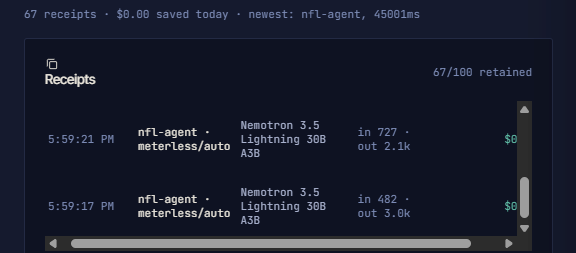
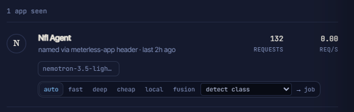

# Sponsor technology

How each sponsor's technology is used in this project, and where to find it in the
code. Everything here can be checked in the repository or in the saved runs under
`examples/`.

## Zetaris: every fact comes from SQL

**Where it sits.** All live data comes from a Zetaris cluster. The agents never read
data files themselves:
- **One way in:** every query goes through `run_sql()` in `app/adapters/zetaris.py`,
  using the UI-proxy route `POST {ZETARIS_BASE_URL}/api/proxy/sql-editor/sqls/run-query`.
- **One statement per call:** `run_sql` rejects SQL with more than one statement.

**Tables.** The seven nflverse tables are `player_stats`, `pbp`, `snap_counts`,
`depth_charts`, `injuries`, `rosters` and `schedules`.
- **Build:** `scripts/build_sample_data.py` builds them as Parquet with nflreadpy.
- **Upload:** they are uploaded to S3.
- **Registration:** they are registered in Zetaris as `NFLVERSE` filestore tables with
  `CREATE LIGHTNING FILESTORE TABLE … FORMAT PARQUET` (`sql/nflverse_create.sql`).
- **Caching:** `sql/nflverse_cache.sql` caches all seven tables after a cluster
  restart. Uncached tables such as `injuries` can take more than 60s to query.

**How the agents use it.** For each question type the Analyst runs a fixed set of
queries (`app/agents/factor_queries.py`):
- **Before the factor queries:** the season context, the player lookup with the
  premise check, and the league memory's roster lookup.
- **What the queries compute:**
  - weekly snap and target share
  - teammates on the injury report
  - pass rate by game script
  - air yards and 20+ yard plays
  - red-zone share
  - points allowed by opponent
  - depth chart order
  - games without the player
  - next opponent from `schedules`, with points allowed to the position and its rank
  - last-name lookup on `rosters` ("Bowers" = Brock Bowers)
  - head-to-head comparisons of two players
- **What the model sees:** the factor agents see only facts computed from these rows.
- **Claims and checks:** every claim in an answer carries the `query_id`, SQL, headers
  and rows it came from, and the Critic checks every number in the answer against them.

**One SQL dialect for both modes.** Sample mode runs the same SQL on DuckDB against
`data/sample/`. The queries are therefore plain standard SQL that runs on both engines:
- no `ILIKE`, `QUALIFY`, `::` casts or double-quoted identifiers
- no `ORDER BY` on an aggregate alias, which Spark rejected in run 7bfa81c3abf1

**Spark sweep.** `scripts/check_factor_queries_live.py` runs every planned query
against the live cluster:
- **Question types:** why, replacement, start_sit, waiver and other, plus compare for
  three pairs (Jameson Williams vs George Pickens, Christian McCaffrey vs Mike Evans,
  an RB against a WR, and Trey McBride vs Brock Bowers), last-name lookups (Bowers,
  McBride, Johnson) and next matchups for a named week.
- **Scoring:** PPR, half-PPR and standard.
- **Players:** eight (Christian Watson, Mike Evans, Puka Nacua, Christian McCaffrey,
  Jameson Williams, George Pickens, Trey McBride and Brock Bowers).
- **Purpose:** it catches SQL that DuckDB accepts but Spark rejects.
- **Errors:** cluster and transport errors are retried once and reported separately
  from SQL errors.
- **Last run (25 October 2026):** 278 distinct queries, 0 SQL errors. Four queries hit
  cluster errors (Thrift `TTransportException` or the 60s timeout) twice; all four passed
  when rerun on their own.

**Fallbacks.**
- **Retry:** a live query that fails fast with a transient cluster error (Thrift
  `TTransportException`, "Could not create ResultSet") is retried once.
- **Cache:** if it still fails, `run_sql` returns a cached result for the exact same
  SQL when one exists in `data/sample/zetaris_cache/`. Otherwise it raises, and the
  Analyst records that query as failed.

## Meterless

### Nightshift runtime: the only model provider

`app/adapters/meterless.py` is the only module that calls a model.
- **API:** it talks to the Nightshift runtime's OpenAI-compatible
  `/v1/chat/completions` endpoint.
- **Request:** each request sends a bearer token, `meterless-app` /
  `meterless-scope` headers, a timeout and `max_tokens`.
- **Retry:** a 5xx or an empty reply is retried once with the same model, then raises.
- **No direct providers:** nothing in the repo calls NVIDIA or any other provider
  directly.

**Model calls in one run:**
- **Planner:** classifies the question.
- **Factor agents:** one call per factor, in parallel.
- **Verdict:** one call, plus one revision per critic round that sends it back.
- **Critic:** the model review.
- **League memory:** a model call to mine league facts, only when code finds cues it
  can't parse.

Every call has a wall-clock limit, and every step has a code-rule fallback. Each reply
says which steps a model produced (`steps` in the API reply, and the header of each
`answer.md`).

### H-MEM engine: league memory

`app/engines/hmem.py` implements the official Meterless H-MEM spec in Python. The spec
is [github.com/Meterless/Meterless](https://github.com/Meterless/Meterless),
`engines/hmem` (Apache-2.0), read at commit `1742dec`. It is a reference architecture
to implement, not a package.

**What we built.** All seven services in spec section 11: `MemoryStoreService`,
`MemoryRetrievalService`, `TrustLedgerService`, the model-extraction step of
`MemoryMiningService`, `ConflictDetectionService` (scan and gated auto-resolve),
`SleepCycleService` (preview, execute with backup, restore) and `DreamingService`
(proposals that take effect only on approval). It follows the spec's:
- record shape
- ranking formula
- feedback deltas
- reinjection format (`[MEMORY CONTEXT]`)
- append-only trust ledger

**The feature it powers.** League memory (`app/agents/memory.py`), turned on by a
`user_id`:
- **Store:** the question's league facts are stored as records. These are team count,
  scoring, rostered players ("my TE is George Kittle", "Jameson Williams on my bench")
  and dropped players.
- **Retrieve:** the records are retrieved for later questions.
- **Effect on answers:** the factor queries compute points in the league's scoring. The
  rule fallbacks skip rostered players, and the Critic's check (f) blocks a pickup of a
  rostered player or full-PPR points in a half-PPR league.
- **Trace:** each run's `memory` trace lines record the stored record IDs, the
  retrieved IDs and their scores.

**Conformance.** The official conformance runner is run unmodified through a thin
TypeScript-to-Python bridge in `scripts/hmem_conformance/`. It passes **13 of 13**
checks (2026-10-25, commit `b2d8c7a`). Before the sleep cycle, conflict detection and
dreaming were built it passed 10 of 13; the 3 failures were those services. Two departures from the spec are deliberate, and both
are documented:
- **Recall scope:** recall is per user, not per chat.
- **Retrieval limits:** league facts use threshold 0 and top N 15, because they are
  standing context.

Full output and details: [hmem-conformance.md](hmem-conformance.md).

**Tests.** The engine has unit tests in `tests/test_hmem.py`, and
`tests/test_hmem_services.py` runs the conflict, sleep and dreaming vectors from the
official vectors file, in process and through the bridge. The feature is tested
end to end across two separate processes in `tests/test_memory_sessions.py`:
1. Session 1 states the league.
2. Session 2 asks only about Mike Evans.
3. It must answer in half-PPR points and must not recommend the rostered Kittle.

## NVIDIA: Nemotron 3.5 Lightning

**Model.** Every agent's model is `nvidia/nemotron-3.5-lightning-30b-a3b`
(`METERLESS_MODEL`), served through Nightshift.

**Traces and replies.** The model that actually answered is recorded per call:
- in the `model` field of each `model_call` trace line, from the runtime's
  `meterless.routed_model` (falling back to the response's `model`)
- in the API reply's `timings.model_calls`

**Receipts.** The Nightshift Console keeps a receipt for each request on its Proof page.
Each one shows:
- the app, `nfl-agent` (set by the adapter's `meterless-app` header)
- the route, `meterless/auto`
- the model, Nemotron 3.5 Lightning 30B A3B
- input and output tokens
- the cost, $0

The Apps page lists the app as "Nfl Agent", named via the `meterless-app` header, with
its request count.

**Prompt design.** The agents' prompts are kept small for a fast model:
- **Factor agents:** each sees one factor's computed facts, not the database schema.
- **Reply format:** every reply is a small JSON object, validated in code. A bad reply
  gets one repair retry.

**Thinking mode.** Requests send `chat_template_kwargs.enable_thinking=false`
(`app/agents/analyst.py`).
- **Nightshift 1.2.7 forwards the flag.** On a tiny prompt it took 0.2s and 8-9
  completion tokens, against 1.6-8.8s and 260-1,455 tokens without the flag.
- **Measured on all the examples.** In the reruns on 25 October 2026:

  | Step | Nightshift 1.2.1 | Nightshift 1.2.7 |
  |---|---|---|
  | Planner | 3.5-27.1s | 0.3-0.4s |
  | Each factor agent | 10.6-60s (one timeout) | 0.4-1.5s |
  | First verdict | 26.9-60s (three timeouts) | 0.7-24.5s |
  | Critic model review | 57.8s, or a timeout at 60-90s (six of seven) | 2-34s |
  | Whole run | 128.7-349.9s | 33.9-151.0s |

  Model steps went from 24 of 33 to 39 of 43 across the five fresh-run examples (the
  rest are rule-based fallbacks).
- **Final reruns (the current examples).** Planner 0.3-2.5s, factor agents 0.5-4.0s,
  first verdict 1.3-5.0s (one failure at 60s), critic review 2.6-22.7s, revision
  0.8-15.6s; whole runs 17.9-134.8s.
- **The revision call was the exception.** With the previous answer plus the critic's
  issues, Nemotron reasoned before replying: 5,900-8,400 completion tokens for a reply
  of about 300 characters, 42-97s, or an empty reply. The revision now gets the facts
  plus the critic's issues as rules, without the previous answer (0.8-15.6s above);
  it still hit its 65s limit twice in the smoke tests.
- **Nightshift 1.2.1 still works, but is slower.** It ignores the flag, so every call
  reasons first and takes about 10-90s. The design's parallel factor agents, per-call
  limits and rule fallbacks came from that (see Limitations in the README).

## Claude Code: how it was built

The project was built in Claude Code, in this repository, from 22 October 2026:
- **Project rules:** `CLAUDE.md` holds the rules every change had to follow:
  - all model calls go through the Meterless adapter
  - all data goes through `run_sql`, one statement per call
  - every step is traced
  - sample mode never loads a pre-written answer
  - there are at most 3 critic rounds
  - numbers are rounded to 1 decimal place
  - every answer carries a disclaimer
- **Workflow:**
  - **Live testing:** Claude Code ran the live examples and read the saved answers.
  - **Turning failures into fixes:** when a live run showed a failure, it became a
    code check and a test. Examples are the approved "Pick up Mike Evans" in
    `examples/archive/`, or a compare question that analysed only one player.
  - **Commits:** the commits are co-authored by Claude.

## Cursor

Cursor: not used. The organizers made Cursor optional on 22 October 2026, and #help-desk confirmed it isn't required on 25 October; the project was built in Claude Code.

## What was unique

- **A Critic that tests timing.** A claim like "his target share rose after Jayden
  Reed got hurt" is checked week by week against the data. The Critic blocks it if the
  rise doesn't start that week, or had already started before it.
- **Premise correction from the data.** "The Bucs' WR1 if Mike Evans is out" is
  corrected to SF from the rosters table before any agent sees the question.
- **Small, parallel factor agents with rule fallbacks.** A slow or failed model call
  costs one factor's model rating, not the whole answer.
- **Honest provenance.** Every answer says which steps a model produced and which the
  code rules produced, and every number links to the SQL and rows it came from.
- **H-MEM to the official spec**, all seven services, with the conformance results
  published, including the earlier failures.
